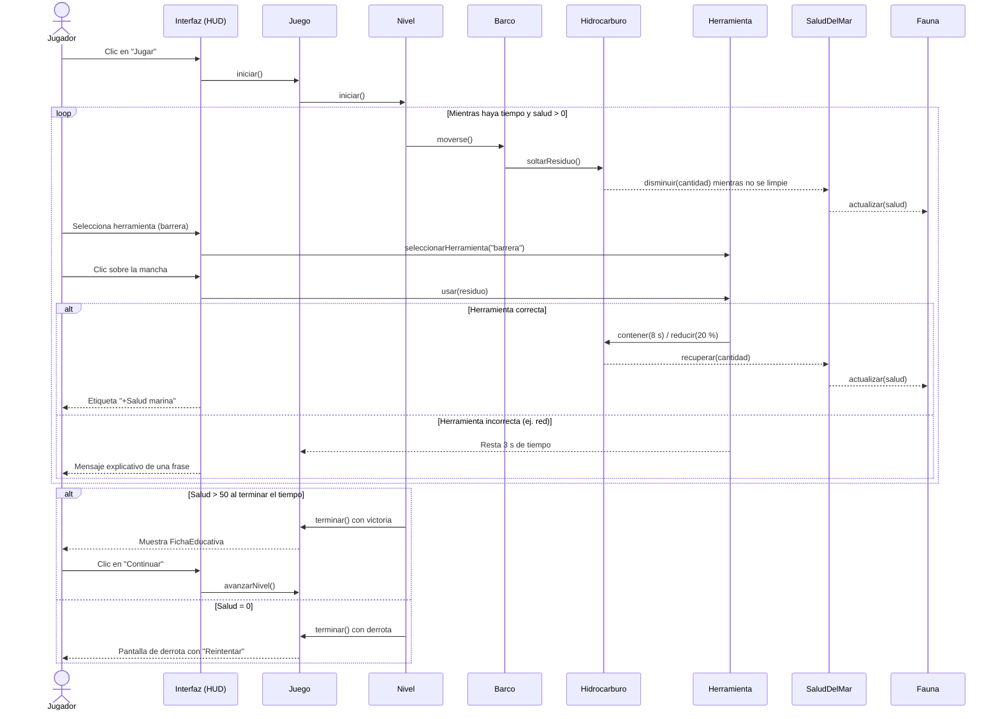

# Diagrama de secuencia — Escenario principal: limpiar una mancha de hidrocarburo

Muestra el escenario principal del juego (RF-01, RF-03, RF-05, RF-06, RF-07, RF-08, RF-09): el jugador inicia la partida, un barco suelta hidrocarburo, el jugador elige la herramienta y la usa (bien o mal), y el nivel termina en victoria (ficha educativa) o derrota (reintentar).

