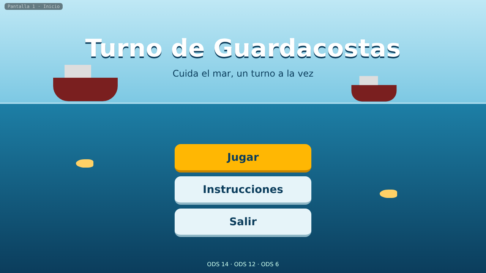
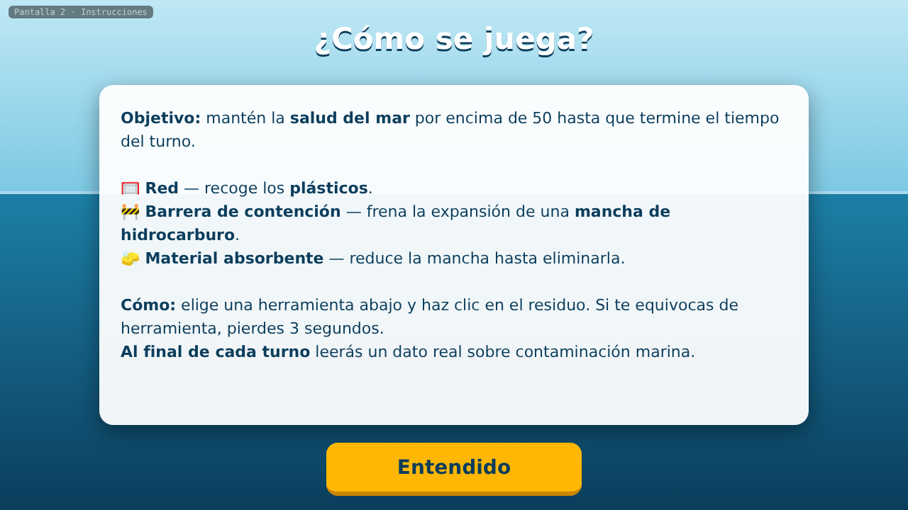
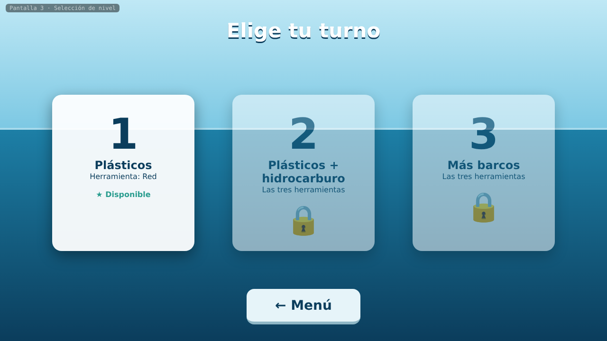
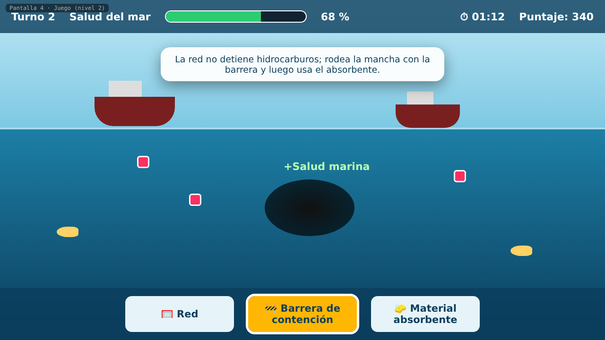
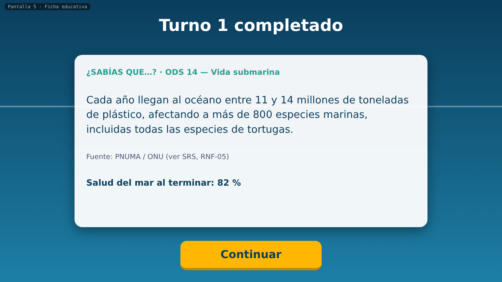
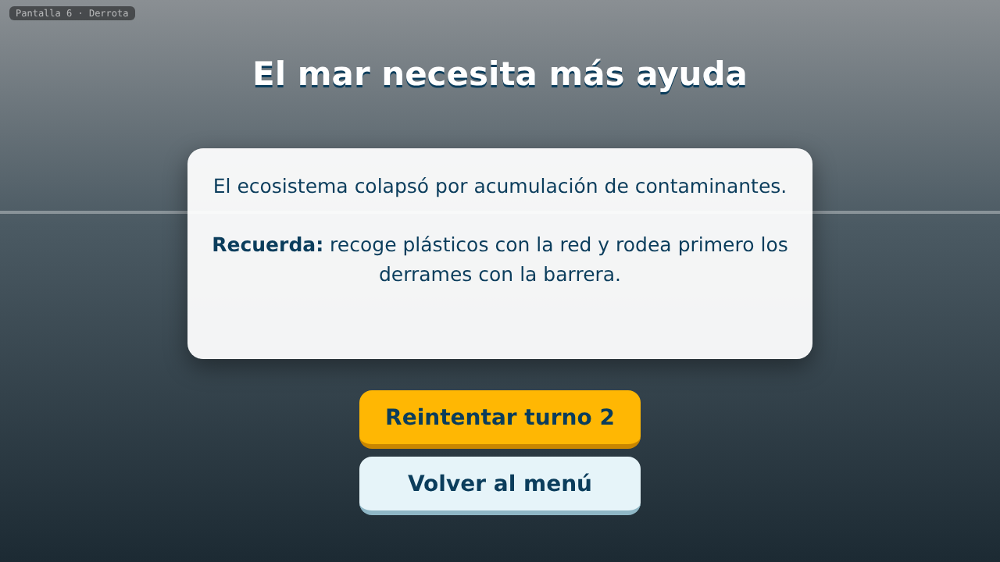
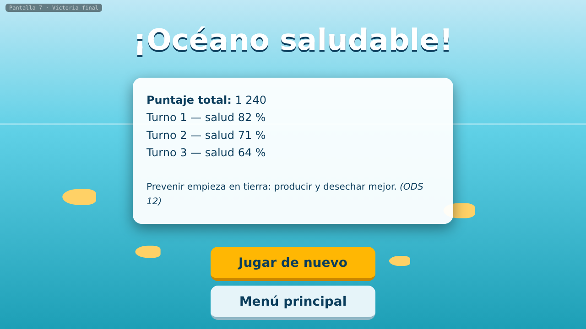

# Diseño de pantallas — Turno de Guardacostas

Bocetos de interfaz (1280×720) de las pantallas del juego, con la paleta y el texto definidos en el SRS y el diseño educativo.

| # | Pantalla | Imagen | Requerimientos |
|---|---|---|---|
| 1 | Inicio / menú principal |  | RF-01 |
| 2 | Instrucciones |  | RNF-01, RF-11 |
| 3 | Selección de nivel (con candados) |  | RF-01, RF-09 |
| 4 | Juego (HUD, herramientas, mensaje de error) |  | RF-02 a RF-07, RF-10, RF-12 |
| 5 | Ficha educativa |  | RF-08, RNF-05 |
| 6 | Derrota y reintento |  | RF-13 |
| 7 | Victoria final |  | RF-09 |
